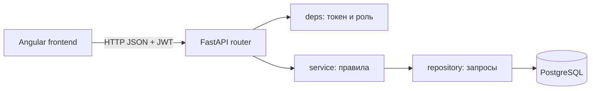

# dstu-dean-booking

Запись студентов ДГТУ на приём к деканам. Студент выбирает период приёма и получает номер в очереди, отдельное время ему не назначается. Декан вызывает номера по порядку и отмечает результат.

В репозитории две части: `backend/` (API на FastAPI) и `frontend/` (Angular).

## Стек

Python, FastAPI, SQLAlchemy, Pydantic, PostgreSQL в Docker, авторизация по JWT.

## Запуск backend

Нужны Docker и Python 3.

```
make db
cd backend
python3 -m venv .venv
.venv/bin/pip install -r requirements.txt
.venv/bin/python -m app.create_admin admin@example.com пароль
cd ..
make run
```

Сервер: http://127.0.0.1:8000, документация и проверка запросов: http://127.0.0.1:8000/docs

База запускается в контейнере (`docker-compose.yml`), порт 5433, пользователь, пароль и база `deanery`. Адрес задан в `backend/app/config.py`. Таблицы создаются при старте сервера.

## Архитектура



## Структура backend

```
backend/app/
  main.py          создание приложения, подключение роутеров, создание таблиц
  config.py        адрес базы, секретный ключ, срок жизни токена
  database.py      подключение к базе, сессия
  security.py      хеш пароля, создание и проверка токена
  deps.py          текущий пользователь и проверка роли
  create_admin.py  создание первого администратора
  models/          таблицы
  schemas/         формат запросов и ответов (S...Base, S...Add, S...Patch, S...)
  routers/         адреса API
  services/        правила записи и периодов
  repositories/    все запросы к базе (select, add, update)
```

## Как это работает

Запрос проходит по цепочке: router, зависимости (токен и роль), service, repository, model, база.

- router принимает запрос и вызывает service
- зависимости из `deps.py` определяют пользователя по токену и проверяют роль
- service содержит правила: места, номера, пересечения периодов, отмены
- repository выполняет запросы к базе и ничего не решает
- model описывает таблицу, schema описывает, что принимаем и что отдаём

Вход: `POST /auth/login` принимает почту и пароль, возвращает токен. Токен передаётся в заголовке `Authorization: Bearer <токен>`. Пароли хранятся как хеш bcrypt. Выхода на сервере нет, клиент просто удаляет токен.

## База данных

Таблицы: `faculties`, `users`, `appeal_topics`, `reception_periods`, `appointments`, `notifications`.

Ограничения в базе:
- уникальна пара период и номер очереди
- у студента одна неотменённая запись на период
- лимит мест и номера положительные
- начало периода раньше окончания

## Роли и эндпоинты

| Роль | Что может |
|---|---|
| без входа | `GET /faculties`, `GET /topics`, `POST /auth/register`, `POST /auth/login` |
| студент | `GET /periods` (параметры `date` и `only_available`), `POST /appointments`, `GET /appointments/my`, `POST /appointments/{id}/cancel`, `GET /notifications`, `POST /notifications/{id}/read` |
| секретарь | `GET /appointments`, `PATCH /appointments/{id}/status`, `POST /topics`, `PATCH /topics/{id}`, `POST /periods`, `PATCH /periods/{id}`, `POST /periods/{id}/cancel` |
| декан | `GET /periods/{id}/queue`, `POST /periods/{id}/call-next`, `PATCH /appointments/{id}/result` |
| администратор | `GET /appointments`, `PATCH /appointments/{id}/status`, `POST /faculties`, `PATCH /faculties/{id}`, `GET /users`, `POST /users`, `PATCH /users/{id}` |

Регистрация создаёт только студентов. Остальные роли создаёт администратор. Первого администратора создаёт `create_admin.py`.

## Правила

- запись возможна только до начала периода и пока есть места
- у студента одна действующая запись на период
- номер выдаётся по порядку и после отмены не используется повторно
- при выдаче номера строка периода блокируется, поэтому лимит не превысить при одновременных запросах
- периоды одного декана не пересекаются
- пока нет записей, период можно менять целиком, после первой записи можно только увеличить лимит или отменить период
- отмена периода отменяет записи и создаёт уведомления
- декан и секретарь работают только со своим факультетом, студент видит только свои записи

## Статусы

Запись: `active`, `called`, `accepted`, `no_show`, `cancelled`.
Период: `open`, `cancelled`.

Запись проходит путь `active`, затем `called` (вызван номер), затем `accepted` или `no_show`. Из `active` и `called` её можно отменить. Статус меняют декан, секретарь и администратор, допустимые переходы проверяются на сервере.

## Что не сделано

- миграции (таблицы создаёт `create_all` при старте)
- автотесты
- подтверждение, что регистрируется настоящий студент
- комментарий декана студенту не отдаётся, его видимость не определена

## Работа с Git

Каждая задача делается в отдельной ветке (`feature/...`, `docs/...`) от `main` и вливается через Pull Request после review второго участника. Прямые коммиты в `main` не делаются.
